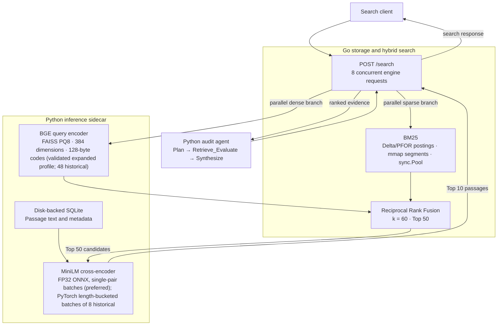
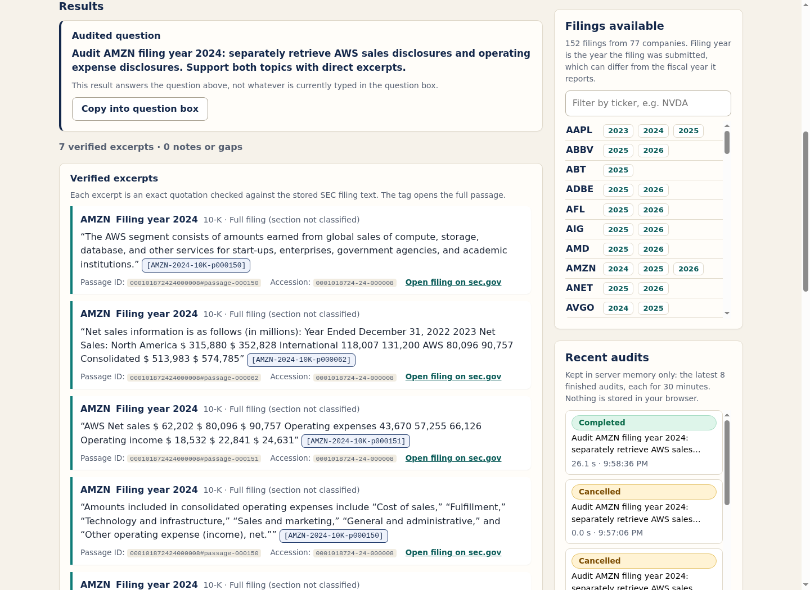

# FinFilings AI

**Disk-backed financial filing search with compressed indexes, hybrid retrieval, and a citation-grounded audit agent.**

FinFilings AI searches SEC 10-K/10-Q passages using a custom Go BM25 engine and FAISS product-quantized vectors, fuses their rankings, and reranks candidates with a cross-encoder. An asynchronous Python agent decomposes audit questions, retries weak retrieval, and publishes source-verified filing excerpts.

The project brings together storage engineering, information retrieval, and bounded agent execution. Its benchmarks use actual SEC filings and published FinQA supporting-fact labels, with raw measurements and limitations preserved.

**Latest UI: [local audit workbench — live verification](bench_kit/results/audit-ui-20261102/RESULTS.md)** · **Latest agent: [AMZN operating-expense fix — full 30-case validation](bench_kit/results/amzn-expense-20261101/RESULTS.md)** · [post-HPE held run (historical)](bench_kit/results/post-hpe-full-20261101/RESULTS.md) · [HPE critic fix — targeted two-replay check](bench_kit/results/hpe-critic-20261101/RESULTS.md) · [parser-v3 adoption — 30-case verified report](bench_kit/results/parser-v3-adoption-20261101/RESULTS.md) · [Verified benchmarks](bench_kit/RESULTS.md) · [Ten audit results](bench_kit/results/phase3/RESULTS.md) · [Ingestion guide](docs/ingestion/README.md) · [Build reports](docs/build/phase1.md)

## Architecture



### Storage and retrieval

- **Compressed sparse index:** delta encoding and PFOR integer bit-packing, immutable binary segments, read-only `syscall.Mmap`, CRC/structure validation, and BM25 scoring. SSE2 packing/unpacking covers 8- and 16-bit widths on amd64; other widths and platforms use scalar kernels.
- **Dense retrieval:** pinned `BAAI/bge-small-en-v1.5` embeddings and FAISS `IndexPQ` with inner-product search: **128 sub-vectors (128-byte codes) in the validated expanded-corpus profile**; `IndexPQ(384, 48, 8)` is the historical Phase 2 configuration, whose results are kept dated below. Raw float32 reference vectors stay in a disk-backed mmap for evaluation; serving uses compressed codes and centroids.
- **Hybrid ranking:** sparse and dense searches run concurrently, then RRF (`k=60`) merges their rank orders. The pinned `cross-encoder/ms-marco-MiniLM-L6-v2` model scores all Top-50 candidates and returns Top-10 passages. The preferred cross-encoder backend is FP32 ONNX with single-pair batches; the PyTorch path (length-bucketed batches of 8) is the historical default.
- **Bounded execution:** Go uses bounded worker pools, search admission, reusable scoring buffers, and a 16-connection listener. Python admits up to 64 inference requests with an HTTP concurrency guard of 128. The service default is one native inference worker; the validated profile is an explicit opt-in of **4 inference workers × 2 threads** (plus optional pressure-triggered dense batching of 8), still bounded by the same admission limits. Excess application work receives HTTP 429 with `Retry-After`; cancellation preserves the native-work limit.
- **Filing filters:** ticker, filing year, section, and accession predicates constrain both retrieval branches before fusion. Sparse predicates compare mmap metadata directly; filtered PQ8 search streams matching compressed codes in blocks of 2,048.

### Audit controller and grounding

Pydantic schemas constrain the planner, critic, and synthesis outputs. The planner creates two or three targeted subqueries; the critic grades relevance from 1–5 and may rewrite each query **at most twice**, preserving its filing filters. The default acceptance threshold is 4.

Synthesis selects exact excerpts from accepted SEC evidence. Each published excerpt carries a generated citation tag, chunk ID, accession number, and SEC filing link. Content and metadata are checked against the acquired source corpus. Unsupported quotes are dropped and missing evidence is flagged. Filing year and fiscal-period end are tracked separately.

Structured generation uses an authenticated Claude Code CLI with file/command tools, MCP integrations, and customizations disabled. The retrieval service itself runs locally without an LLM account.

## Verified results

Measured on an **AMD Ryzen 7 5800H (8 physical cores, 16 logical CPUs), Linux**, with CPU model inference. These are finite local experiments on a non-isolated desktop with warm caches/models. The tables below keep their original dated measurements (the Phase 1–4 rows are from October 30–31, 2026 on earlier corpora/profiles and are not rewritten); the latest verified adoption summary is under "Latest: parser-v3" below. [The consolidated report](bench_kit/RESULTS.md) contains raw evidence, workload definitions, and reproduction details.

| Component | Measurement | Result | Workload |
|---|---|---:|---|
| Sparse index | Median indexing throughput | **20,352 passages/s** | 702 real SEC passages; ten independent builds |
| Sparse index | Validated mmap Open, round medians | **0.251–0.292 ms** | Includes CRC and structural validation |
| Sparse index | Worst round query p99 | **0.048 ms** | 10 million in-process searches; 50 configured workers |
| Sparse benchmark | Post-load process RSS | **42–45 MiB** | Includes runtime, benchmark buffers, and mapped pages |
| Hybrid + reranker | nDCG@10 | **0.5757** | 100 fixed FinQA support-fact queries; 19,511 passages |
| PQ8 vectors | Native payload reduction | **95.56%** | Float32 vectors → PQ8 codes plus centroids |
| PQ8 vectors | Isolated RSS-growth decrease | **92.39%** | Three independent load/search probes per representation |
| Audit agent | Verified published citations | **54/54** | Ten prompts; median **23.34 s** per audit |

Sparse timing covers BM25 calls on 702 cached passages. The HTTP measurements below cover connection setup, queueing, full responses, and validation over the larger hybrid corpus. Vector savings apply to the vector component; the full model sidecar used approximately **1.50 GiB RSS** after the Phase 2 evaluation.

The audit run had **six fully covered positive cases, two partial cases, and two correct abstentions**. Citation checks establish exact source grounding; they are not a human-labeled answer-accuracy score. [Inspect every prompt, citation, retry, and gap](bench_kit/results/phase3/RESULTS.md).

Expanded-corpus agent revalidation on 49,452 passages verifies **61/61 citations** across the same ten prompts: eight audits with every subquery cited, one partial, one correct abstention; median **22.70 s**. These are source-grounding checks, not human answer-accuracy labels. [Every expanded audit, retry and evidence gap](bench_kit/results/phase3-expanded-20261031/RESULTS.md).

The AMZN cloud gap was subsequently fixed in an affected-audit rerun: **8/8 verified citations, four per company**, one retry, and no unresolved flags. This follow-up retains useful partial evidence within the five-passage context limit; it does not replace the original ten-audit measurements. [Diagnosis and rerun](bench_kit/results/agent-cloud-gap-20261031/RESULTS.md).

Broad agent validation (frozen `broad-validation-v1`, 30 cases): **30/30 cases verified** (zero transport/model/structural failures): **26 supported, 1 partial gap, 3 expected-unavailable**; **172** independently verified published citations, 86 retrieval calls, 24 retries, median **23.64 s**, 143 Claude calls (`claude-haiku-5-5`). "Supported" means every planned subquery on an *available* scope has a verified published quote; it does **not** mean 26 complete answers. Both mixed cases have their available side fully cited (2/2, 1/1) with the unavailable scope withheld; available-scope coverage is **53/54 = 98.1481 %**. The one gap is HPE filing year 2024 (stayed at critic score 3 through two retries; the amount and remaining authorization sit in adjacent passages 35/36 split mid-sentence, so this is not evidence the disclosure is absent). One TSLA model-proposed quote was rejected by exact-quote grounding. The suite is ten historical prompts plus twenty source-informed regression fixtures over 30 companies with citations; it is not independent human gold, not a semantic accuracy score, and not load latency. [Every case, gap and release gate](bench_kit/results/broad-validation-20261101/RESULTS.md); suite definition and gate documentation in [`bench_kit/suites/`](bench_kit/suites/README.md).

Parser follow-up: Morgan Stanley titled-heading boundary fix (parser `deterministic-canonical-heading-v3-go`, default for new ingestions), independently verified by Codex on a fresh replay. Real-source diagnosis: the old "3,000 lost MD&A words" note was wrong — Item 7 (v2: 32,278 words / 127 chunks) over-ran into Item 7A; v3 closes it at the Item 7A heading (20,497 words / 81 chunks, **11,781 Item 7A words removed**). There is no MD&A coverage gain. Item 1A and Item 8 are identical; of 361 v2 passages, 315 remain in v3, 46 IDs exist only in v2, and one ID (`…item7#passage-000080`) changed. Equivalence claim is limited to the 361 stored indexed passages matching the frozen corpus in full text and metadata; the current SEC document (9,714,819 bytes, SHA-256 `3002143b…78b2`) is **not** the archived 9,714,832-byte copy, whose raw HTML is gone, so no full-visible-text claim is made. Codex-verified: 40 application + 50 bench tests, `go vet`, `go test -race ./...` with the real 9.7 MB file, original four filings identical, shard-router reopen with stable descriptor/goroutine counters. Offline recheck of the saved broad run still passes 30/30 and 172 citations with all source/index/model hashes matching (code drift only in `pkg/ingest/parser.go`); the broad agent was **not** rerun. The active 49,452-passage corpus/indexes still hold the v2 Morgan Stanley Item 7; adopting v3 needs a separately versioned rebuild and re-benchmark (not done). The HPE 2024 critic gap is unchanged. [Evidence and limitations](bench_kit/results/parser-boundaries-20261101/RESULTS.md) · [diagnosis](docs/build/edgar-ingest.md).

### 50-worker HTTP load: optimized serving

Each endpoint received **200 requests from 50 persistent clients**, using the same 100 real queries twice. Five warmup requests were excluded; the two scenarios ran sequentially with a new TCP connection per request.

| Endpoint | p50 | p95 | p99 | Successful QPS | Failures |
|---|---:|---:|---:|---:|---:|
| Full hybrid `/search` | 28.025 s | 30.092 s | 30.676 s | **1.756** | **0/200** |
| BGE + PQ8 `/dense` | 0.831 s | 0.841 s | 0.844 s | **59.522** | **0/200** |

Length-bucketed reranking improved hybrid throughput **1.80×** and reduced p99 **46.45%** against the original load. Bounded admission raised dense successes from **11/200 to 200/200**. A real-model replay of all 100 original candidate sets preserved nDCG@10 at **0.575744**; tiny floating-point differences changed two Top-10 orders.

Hybrid search remains CPU/queue-bound at 50 clients. The dense run lasted 3.36 seconds; these results do not establish sustained capacity or a production SLO. Percentiles are exact empirical nearest-rank values; nanosecond observations are retained.

[Before/after comparison](bench_kit/RESULTS.md#optimization--verified-beforeafter) · [Raw load report](bench_kit/results/phase4/run-20261031T063553Z/load/report.json) · [Terminal log](bench_kit/results/phase4/run-20261031T063553Z/terminal.log) · [Quality replay](bench_kit/results/optimization/rerank-quality.json)

### Expanded SEC corpus: improved dense quality

The newer 49,452-passage run uses 128-byte PQ8 codes, selected without relevance labels. On the same 100 financial queries, recall against exact float32 retrieval rose from **53.1% to 83.8%**, dense nDCG@10 from **0.3515 to 0.4823**, and reranked nDCG@10 from **0.5372 to 0.5537**. Native vector payload savings remain **91.15%**. These results use a different corpus from the original Phase 2 table above; additional SEC passages are not exhaustively labeled.

The profiled float32 ONNX cross-encoder now defaults to single-pair batches. At four workers × two threads, 50-client hybrid p99 improves **42.50 → 39.92 s** against a fresh batch-two control, with identical Top-10 ordering on all 100 queries. [Inspect CPU, queueing, dense-latency trade-offs and raw measurements](bench_kit/results/optimization/pair-reuse-20261031/RESULTS.md).

Pressure-triggered BGE query batching reduces dense p99 **1.256 → 0.553 s** in matched 2,000-request, 50-client probes, with identical concurrent Top-100 rankings. Hybrid throughput stays about **1.38 QPS** and p99 about **40 s** (39.59 → 40.08 s in the paired run). [Measurements, bounds and launch flags](bench_kit/results/optimization/dense-batching-20261031/RESULTS.md).

New builds default to 128 sub-vectors. Use `--subvectors 48` for the historical compact configuration. [Full quality and bounded-concurrency benchmark](bench_kit/results/ingest/scale-v2-20261031/benchmark-pq128-workers4-threads2/RESULTS.md).

### Latest: parser-v3 mixed-lineage corpus (November 1, 2026)

A new, separately versioned corpus (`data/sec-scale-v3-evaluation-20261101`, 49,406 passages vs 49,452): only Morgan Stanley was reparsed with parser v3 (361 → 315 passages: 314 identical, 46 removed Item 7A text, 1 changed ID); **147 filings were not reparsed**, no new raw files were fetched for them, and everything else is byte-identical. The current MS source (SHA-256 `3002143b…78b2`, 9,714,819 bytes) is not the archived file (`57698077…12df`, 9,714,832 bytes, gone); the cause of the 13-byte difference is unknown and the report records both identities. New sparse and PQ128 indexes were built (49,405 vectors reused bit-identically, 1 encoded, PQ codebook retrained). v2 artifacts, `broad-validation-v1` and all earlier evidence are unchanged.

Matched run (same 100 FinQA **development** queries, 4 inference workers × 2 threads, 50 clients, 200 requests/endpoint, zero failures in 400/400 requests per run, every nDCG and latency recomputed independently by Codex): reranked nDCG@10 **0.5537183500706869 → 0.5539997505715865**, hybrid 0.50780475359511 → 0.5100210113496677, PQ recall@10 0.838 → 0.841, native vector payload savings 91.1485 % (payload only, not whole-process RSS), hybrid p99 **47.812667999 s → 44.999937571 s**, dense p99 0.575851645 → 0.556806811 s. **Disclosed regression: dense-only nDCG@10 fell 0.48229729941572386 → 0.46732239998883435 (−0.01497).** The small upward movements are not attributed to the MS fix (the PQ codebook was retrained and the candidate pool changed). These are development-set regression checks — not held-out, not SEC retrieval accuracy; load figures are single finite closed-loop runs on a non-isolated Ryzen 7 5800H (8 physical / 16 logical CPUs, CPU inference), not an SLA.

**Agent audit: 30/30 verified, 0 failures, 187 citations, 51/52 = 98.08 % coverage, all pre-registered gates pass; dense-only nDCG@10 fell 0.01497 (disclosed). Published as `6f18c04` (recorded in Git history); no deployment performed. The HPE 2024 gap shown there is the historical baseline; see the follow-up report above.** [Full 30-case report](bench_kit/results/parser-v3-adoption-20261101/RESULTS.md) · [runbook](docs/build/parser-v3-adoption.md)

### Latest: AMZN operating-expense fix and full 30-case revalidation (November 2, 2026)

The full frozen `broad-validation-v2` suite (same 49,406-passage corpus, indexes and models) was rerun as `full-run-05` and independently verified with the strict-code verifier: **30/30 cases, 0 failures, 178 exact-verified citations, 52/52 available subqueries cited, 27 supported + 3 expected-unavailable**; mixed cases withhold the absent side. 79 retrievals, 19 retries, 136 model calls, median 21.03 s; 4 inference workers × 2 threads, ≤2 retries, 5-passage context. Generic fixes, none company- or ID-specific: a fresh-top-4 context budget, opaque handles for quote selection, user-goal/search-hint separation with a scope-first critic, and a narrow typed empty-evidence stop (an intentional contract change to at most 2 retries; not exercised live). Four earlier fresh attempts failed their gates and are preserved.

Limits: source-informed fixtures, not human gold or accuracy; one nondeterministic run per attempt; extractive quotes; no fresh load, retrieval or Go race/vet run; no deployment. [Full report](bench_kit/results/amzn-expense-20261101/RESULTS.md) · [runbook](docs/build/amzn-expense.md) · [historical held run](bench_kit/results/post-hpe-full-20261101/RESULTS.md)

## Run locally

### 1. Install dependencies

The verified environment uses **Linux, Go 1.24 or later, and Python 3.10**. Python packages are pinned in [py/requirements.txt](py/requirements.txt). Initial data/model acquisition requires network access. The audit agent additionally requires an installed, authenticated Claude Code CLI.

```bash
git clone https://github.com/JCHETAN26/FinFilings-AI.git
cd FinFilings-AI

python3 -m venv .venv
source .venv/bin/activate
python -m pip install --upgrade pip
python -m pip install torch==2.10.0 --index-url https://download.pytorch.org/whl/cpu
python -m pip install -r py/requirements.txt

export PYTHONPATH="$PWD/py"
export HF_HOME="$PWD/models/hf-cache"
export HF_HUB_DISABLE_XET=1
export OPENBLAS_NUM_THREADS=1 OMP_NUM_THREADS=4 NUMBA_NUM_THREADS=4
```

If your workspace filesystem does not support symlinks, create the virtual environment on a filesystem that does. Keep the model cache on persistent storage. The existing Go module path remains `github.com/JCHETAN26/FinFillings-AI`, as declared in `go.mod`; use the clone URL above.

### 2. Acquire passages and build indexes

Set `SEC_USER_AGENT` to your project identifier and a valid contact email before downloading SEC data. The commands below are for a first build; use fresh index output directories, or skip builds when reusing existing verified artifacts.

```bash
export SEC_USER_AGENT='YourProject your.email@example.com'

python bench_kit/prepare_sec.py
python bench_kit/fetch_finqa.py --user-agent "$SEC_USER_AGENT"
python bench_kit/prepare_finqa.py --train-contexts 500 --query-limit 100
python py/fetch_models.py --cache-dir "$HF_HOME/hub"
python py/embed.py

mkdir -p models/bin
go build -o models/bin/finfilings ./cmd/finfilings
go build -o models/bin/loadtest ./bench_kit/load
./models/bin/finfilings -mode build
```

This downloads four real SEC 10-K filings, prepares FinQA report passages and supporting-fact labels, generates embeddings, trains PQ8, and builds the sparse index. Model revisions and weight hashes are pinned. FinQA train/dev files are pinned; the SEC ticker snapshot is cached and hashed. A different ticker snapshot can change corpus eligibility, so compare generated provenance when reproducing the recorded corpus.

Datasets, indexes, model weights, environments, and binaries are excluded from Git. On a fresh clone, build them before running retrieval or artifact-dependent Python tests.

### 3. Start the two services

In one terminal, activate the environment and start the model sidecar:

```bash
source .venv/bin/activate
export PYTHONPATH="$PWD/py"
export HF_HOME="$PWD/models/hf-cache"
export OPENBLAS_NUM_THREADS=1 OMP_NUM_THREADS=4
python py/service.py
```

In another terminal, start the Go hybrid bridge:

```bash
./models/bin/finfilings -mode serve
```

The services bind to loopback: Go on **8765**, Python on **8766**. Check `/health` on either port. Query the full pipeline:

```bash
curl --fail --silent --show-error http://127.0.0.1:8765/search \
  -H 'Content-Type: application/json' \
  --data '{"query":"supply-chain manufacturing risks","rerank":true,"filters":{"ticker":"AAPL","year":2023}}'
```

The response contains sparse, dense, fused, and reranked results. Reranked passages include text and filing metadata; corpus fingerprints must match across services.

### 4. Run a grounded audit

With both services running and Claude Code installed:

```bash
claude auth login
PYTHONPATH=py python -m agent.state_machine \
  'Compare AAPL filing year 2023 and NVDA filing year 2024 supply-chain risks.' \
  --json
```

The JSON result includes the plan, per-hop queries and grades, retries, accepted evidence, final markdown, citations, and evidence-gap flags. Remove `--json` for markdown output.

### 5. Local audit workbench (browser UI)

One command starts the sidecar, the Go bridge and a loopback-only web UI over the current parser-v3 corpus, verifying provenance first. It needs the local artifacts named in the build doc and a signed-in Claude Code CLI; it downloads nothing.

```bash
python3 scripts/serve-audit-ui.py        # prints http://127.0.0.1:8766/ once the UI is actually ready; add --browser to open it
```

From a Mac, tunnel to the Linux host with the same port: `ssh -N -L 8766:127.0.0.1:8766 USER@HOST`, then browse `http://127.0.0.1:8766/`. Single-user, unauthenticated, loopback only, one audit at a time; needs the offline artifacts and a signed-in Claude CLI. Verified with real Chrome on three frozen scenarios (source/structural checks, not answer accuracy or load latency): [UI verification report](bench_kit/results/audit-ui-20261102/RESULTS.md) · [design and limits](docs/build/audit-ui.md).



## Manifest-driven ingestion

The new [streaming ingestion path](docs/ingestion/README.md) accepts a JSONL manifest of local raw filings or SEC archive URLs. It shares an identified, paced EDGAR client (default five requests/second, maximum ten), extracts deterministic Item 1A / Item 7 / Item 8 passages using disk-backed parsing, and streams them into immutable Go shards. Final publication is atomic; duplicate accessions and ambiguous sections are errors.

```bash
mkdir -p models/bin
go build -o models/bin/ingest ./cmd/ingest
PYTHONPATH=py python -m ingest.pipeline \
  --manifest filings.jsonl \
  --output indexes/sectioned-production
```

See the ingestion guide for manifest rows and SEC User-Agent configuration. A replay of four real filings produced **443 section-tagged passages across seven shards and 28 binary segments**. A separate 6.86 MB filing test passed six parser/resource cycles and six Go build/mmap/search/close cycles, with no observed descriptor, mapping or goroutine leaks. [Verification evidence](bench_kit/results/ingest/real/report.json).

Each shard uses the existing `index.Open` loader. The hybrid service routes sparse searches across shards; vector search uses the consolidated corpus index. The expanded agent evaluation enrolls 152 trusted SEC filing sources. The original benchmark indexes retain their recorded contents and fingerprints.

## Reproduce tests and benchmarks

After preparing the artifacts, run the repository checks:

```bash
go test ./...
go test -race ./...
go test -tags=purego ./...
go vet ./...
python -m unittest discover -s py -p 'test_*.py'
```

Tests that open HTTP listeners require loopback sockets. Synthetic documents appear only in labeled unit/allocation fixtures; headline retrieval and load measurements use actual source data.

With the manual services running, evaluate retrieval against the prepared qrels:

```bash
python bench_kit/verify_phase2.py
python bench_kit/eval_hybrid.py --out bench_kit/results/local-hybrid
python bench_kit/profile_rerank.py
```

Stop the manual services before using the supervisors below. Each supervisor starts both services, checks their health and corpus fingerprints, captures logs, and shuts them down after completion:

```bash
# Ten real-model audit prompts, including unavailable-evidence cases.
python scripts/verify-phase3.py

# Same 50-worker HTTP workload used in the before/after comparison.
python scripts/verify-phase4.py

# Independently recompute CSV percentiles and regenerate the master report.
python bench_kit/consolidate.py
```

The standalone `models/bin/loadtest` also accepts `-workers`, `-requests`, `-timeout`, endpoint URLs, and a fresh `-output` directory. See [bench_kit/README.md](bench_kit/README.md) for the sparse benchmark and the evaluation harnesses.

## Repository map

| Path | Responsibility |
|---|---|
| [`pkg/model/`](pkg/model) | SEC records and filing predicates |
| [`pkg/index/`](pkg/index) | PFOR/SIMD codecs, mmap segments, BM25, pooled buffers, bounded indexing/search |
| [`pkg/ingest/`](pkg/ingest) | Streaming JSONL-to-shard builder and atomic catalog publication |
| [`pkg/hybrid/`](pkg/hybrid) | Concurrent sparse/dense retrieval, RRF, sidecar contracts |
| [`cmd/finfilings/`](cmd/finfilings) | Streaming sparse-index builder and HTTP bridge |
| [`py/`](py) | Embeddings, PQ8 ingestion, model sidecar, cross-encoder |
| [`py/ingest/`](py/ingest) | EDGAR client, deterministic section parser and manifest coordinator |
| [`py/agent/`](py/agent) | Structured planner, critic loop, state machine, citation grounding |
| [`py/audit_web/`](py/audit_web), [`ui/`](ui) | Local single-user audit workbench: bounded job manager, loopback API, native HTML/CSS/JS |
| [`bench_kit/`](bench_kit) | Quality, memory, audit and HTTP load evaluation; consolidated results |
| [`scripts/`](scripts) | Verification and service-lifetime supervisors |
| [`docs/build/`](docs/build) | Storage, retrieval and agent design reports |

## Current scope and limitations

- The acquired SEC corpus contains four 10-K filings. The data model supports 10-K/10-Q forms; the current benchmark does not establish 10-Q coverage or large-corpus performance.
- Original benchmark SEC passages retain unclassified sections. The new ingestion path tags verified Item 1A, Item 7 and Item 8 headings; ambiguous or unsupported layouts fail for review. The original agent benchmark's exact Item 1A test remains an abstention.
- The broad agent suite measures structural source grounding on one corpus snapshot and one model sample; see its limitations before quoting any number.
- FinQA supports retrieval evaluation, but its passages lack verified SEC accessions. Published audit claims use the verified SEC registry.
- Synthesis publishes exact source excerpts. Derived calculations and independently validated abstractive financial conclusions are outside the current implementation.
- Tenant authentication/isolation, distributed serving, and production availability guarantees are not implemented. The local audit workbench (`ui/`) is single-user and unauthenticated; services are local and loopback-bound.
- Results cover finite, warm local workloads. The source hashes, raw logs, negative cases, and failed preliminary attempts remain available for review.
