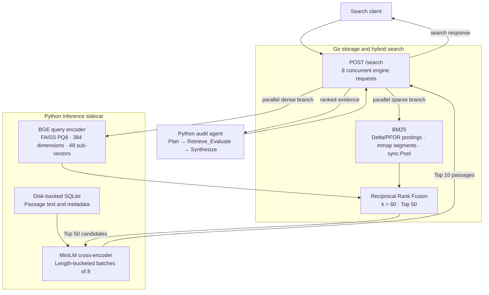

# FinFilings AI

**Disk-backed financial filing search with compressed indexes, hybrid retrieval, and a citation-grounded audit agent.**

FinFilings AI searches SEC 10-K/10-Q passages using a custom Go BM25 engine and FAISS product-quantized vectors, fuses their rankings, and reranks candidates with a cross-encoder. An asynchronous Python agent decomposes audit questions, retries weak retrieval, and publishes source-verified filing excerpts.

The project brings together storage engineering, information retrieval, and bounded agent execution. Its benchmarks use actual SEC filings and published FinQA supporting-fact labels, with raw measurements and limitations preserved.

[Verified benchmarks](bench_kit/RESULTS.md) · [Ten audit results](bench_kit/results/phase3/RESULTS.md) · [Ingestion guide](docs/ingestion/README.md) · [Build reports](docs/build/phase1.md)

## Architecture



### Storage and retrieval

- **Compressed sparse index:** delta encoding and PFOR integer bit-packing, immutable binary segments, read-only `syscall.Mmap`, CRC/structure validation, and BM25 scoring. SSE2 packing/unpacking covers 8- and 16-bit widths on amd64; other widths and platforms use scalar kernels.
- **Dense retrieval:** pinned `BAAI/bge-small-en-v1.5` embeddings and `IndexPQ(384, 48, 8)` with inner-product search. Raw float32 reference vectors stay in a disk-backed mmap for evaluation; serving uses compressed codes and centroids.
- **Hybrid ranking:** sparse and dense searches run concurrently, then RRF (`k=60`) merges their rank orders. The pinned `cross-encoder/ms-marco-MiniLM-L6-v2` model scores all Top-50 candidates and returns Top-10 passages. Length bucketing reduces padding work.
- **Bounded execution:** Go uses bounded worker pools, search admission, reusable scoring buffers, and a 16-connection listener. Python admits up to 64 inference requests behind one native inference worker, with an HTTP concurrency guard of 128. Excess application work receives HTTP 429 with `Retry-After`; cancellation preserves the native-work limit.
- **Filing filters:** ticker, filing year, section, and accession predicates constrain both retrieval branches before fusion. Sparse predicates compare mmap metadata directly; filtered PQ8 search streams matching compressed codes in blocks of 2,048.

### Audit controller and grounding

Pydantic schemas constrain the planner, critic, and synthesis outputs. The planner creates two or three targeted subqueries; the critic grades relevance from 1–5 and may rewrite each query **at most twice**, preserving its filing filters. The default acceptance threshold is 4.

Synthesis selects exact excerpts from accepted SEC evidence. Each published excerpt carries a generated citation tag, chunk ID, accession number, and SEC filing link. Content and metadata are checked against the acquired source corpus. Unsupported quotes are dropped and missing evidence is flagged. Filing year and fiscal-period end are tracked separately.

Structured generation uses an authenticated Claude Code CLI with file/command tools, MCP integrations, and customizations disabled. The retrieval service itself runs locally without an LLM account.

## Verified results

Measured on an **AMD Ryzen 7 5800H, 16 logical CPUs, Linux**, with CPU model inference. These are finite local experiments on a non-isolated desktop with warm caches/models. [The consolidated report](bench_kit/RESULTS.md) contains raw evidence, workload definitions, and reproduction details.

| Component | Measurement | Result | Workload |
|---|---|---:|---|
| Sparse index | Median indexing throughput | **20,352 passages/s** | 702 real SEC passages; ten independent builds |
| Sparse index | Validated mmap Open, round medians | **0.251–0.292 ms** | Includes CRC and structural validation |
| Sparse index | Worst round query p99 | **0.048 ms** | 10 million in-process searches; 50 configured workers |
| Sparse benchmark | Post-load process RSS | **42–45 MiB** | Includes runtime, benchmark buffers, and mapped pages |
| Hybrid + reranker | nDCG@10 | **0.5757** | 100 fixed FinQA support-fact queries; 19,511 passages |
| PQ8 vectors | Native payload reduction | **95.56%** | Float32 vectors → PQ8 codes plus centroids |
| PQ8 vectors | Isolated RSS-growth decrease | **92.39%** | Three independent load/search probes per representation |
| Audit agent | Verified published citations | **54/54** | Ten prompts; median **23.34 s** per audit |

Sparse timing covers BM25 calls on 702 cached passages. The HTTP measurements below cover connection setup, queueing, full responses, and validation over the larger hybrid corpus. Vector savings apply to the vector component; the full model sidecar used approximately **1.50 GiB RSS** after the Phase 2 evaluation.

The audit run had **six fully covered positive cases, two partial cases, and two correct abstentions**. Citation checks establish exact source grounding; they are not a human-labeled answer-accuracy score. [Inspect every prompt, citation, retry, and gap](bench_kit/results/phase3/RESULTS.md).

### 50-worker HTTP load: optimized serving

Each endpoint received **200 requests from 50 persistent clients**, using the same 100 real queries twice. Five warmup requests were excluded; the two scenarios ran sequentially with a new TCP connection per request.

| Endpoint | p50 | p95 | p99 | Successful QPS | Failures |
|---|---:|---:|---:|---:|---:|
| Full hybrid `/search` | 28.025 s | 30.092 s | 30.676 s | **1.756** | **0/200** |
| BGE + PQ8 `/dense` | 0.831 s | 0.841 s | 0.844 s | **59.522** | **0/200** |

Length-bucketed reranking improved hybrid throughput **1.80×** and reduced p99 **46.45%** against the original load. Bounded admission raised dense successes from **11/200 to 200/200**. A real-model replay of all 100 original candidate sets preserved nDCG@10 at **0.575744**; tiny floating-point differences changed two Top-10 orders.

Hybrid search remains CPU/queue-bound at 50 clients. The dense run lasted 3.36 seconds; these results do not establish sustained capacity or a production SLO. Percentiles are exact empirical nearest-rank values; nanosecond observations are retained.

[Before/after comparison](bench_kit/RESULTS.md#optimization--verified-beforeafter) · [Raw load report](bench_kit/results/phase4/run-20261031T063553Z/load/report.json) · [Terminal log](bench_kit/results/phase4/run-20261031T063553Z/terminal.log) · [Quality replay](bench_kit/results/optimization/rerank-quality.json)

## Run locally

### 1. Install dependencies

The verified environment uses **Linux, Go 1.24 or later, and Python 3.10**. Python packages are pinned in [py/requirements.txt](py/requirements.txt). Initial data/model acquisition requires network access. The audit agent additionally requires an installed, authenticated Claude Code CLI.

```bash
git clone https://github.com/JCHETAN26/FinFilings-AI.git
cd FinFilings-AI

python3 -m venv .venv
source .venv/bin/activate
python -m pip install --upgrade pip
python -m pip install torch==2.10.0 --index-url https://download.pytorch.org/whl/cpu
python -m pip install -r py/requirements.txt

export PYTHONPATH="$PWD/py"
export HF_HOME="$PWD/models/hf-cache"
export HF_HUB_DISABLE_XET=1
export OPENBLAS_NUM_THREADS=1 OMP_NUM_THREADS=4 NUMBA_NUM_THREADS=4
```

If your workspace filesystem does not support symlinks, create the virtual environment on a filesystem that does. Keep the model cache on persistent storage. The existing Go module path remains `github.com/JCHETAN26/FinFillings-AI`, as declared in `go.mod`; use the clone URL above.

### 2. Acquire passages and build indexes

Set `SEC_USER_AGENT` to your project identifier and a valid contact email before downloading SEC data. The commands below are for a first build; use fresh index output directories, or skip builds when reusing existing verified artifacts.

```bash
export SEC_USER_AGENT='YourProject your.email@example.com'

python bench_kit/prepare_sec.py
python bench_kit/fetch_finqa.py --user-agent "$SEC_USER_AGENT"
python bench_kit/prepare_finqa.py --train-contexts 500 --query-limit 100
python py/fetch_models.py --cache-dir "$HF_HOME/hub"
python py/embed.py

mkdir -p models/bin
go build -o models/bin/finfilings ./cmd/finfilings
go build -o models/bin/loadtest ./bench_kit/load
./models/bin/finfilings -mode build
```

This downloads four real SEC 10-K filings, prepares FinQA report passages and supporting-fact labels, generates embeddings, trains PQ8, and builds the sparse index. Model revisions and weight hashes are pinned. FinQA train/dev files are pinned; the SEC ticker snapshot is cached and hashed. A different ticker snapshot can change corpus eligibility, so compare generated provenance when reproducing the recorded corpus.

Datasets, indexes, model weights, environments, and binaries are excluded from Git. On a fresh clone, build them before running retrieval or artifact-dependent Python tests.

### 3. Start the two services

In one terminal, activate the environment and start the model sidecar:

```bash
source .venv/bin/activate
export PYTHONPATH="$PWD/py"
export HF_HOME="$PWD/models/hf-cache"
export OPENBLAS_NUM_THREADS=1 OMP_NUM_THREADS=4
python py/service.py
```

In another terminal, start the Go hybrid bridge:

```bash
./models/bin/finfilings -mode serve
```

The services bind to loopback: Go on **8765**, Python on **8766**. Check `/health` on either port. Query the full pipeline:

```bash
curl --fail --silent --show-error http://127.0.0.1:8765/search \
  -H 'Content-Type: application/json' \
  --data '{"query":"supply-chain manufacturing risks","rerank":true,"filters":{"ticker":"AAPL","year":2023}}'
```

The response contains sparse, dense, fused, and reranked results. Reranked passages include text and filing metadata; corpus fingerprints must match across services.

### 4. Run a grounded audit

With both services running and Claude Code installed:

```bash
claude auth login
PYTHONPATH=py python -m agent.state_machine \
  'Compare AAPL filing year 2023 and NVDA filing year 2024 supply-chain risks.' \
  --json
```

The JSON result includes the plan, per-hop queries and grades, retries, accepted evidence, final markdown, citations, and evidence-gap flags. Remove `--json` for markdown output.

## Manifest-driven ingestion

The new [streaming ingestion path](docs/ingestion/README.md) accepts a JSONL manifest of local raw filings or SEC archive URLs. It shares an identified, paced EDGAR client (default five requests/second, maximum ten), extracts deterministic Item 1A / Item 7 / Item 8 passages using disk-backed parsing, and streams them into immutable Go shards. Final publication is atomic; duplicate accessions and ambiguous sections are errors.

```bash
mkdir -p models/bin
go build -o models/bin/ingest ./cmd/ingest
PYTHONPATH=py python -m ingest.pipeline \
  --manifest filings.jsonl \
  --output indexes/sectioned-production
```

See the ingestion guide for manifest rows and SEC User-Agent configuration. A replay of four real filings produced **443 section-tagged passages across seven shards and 28 binary segments**. A separate 6.86 MB filing test passed six parser/resource cycles and six Go build/mmap/search/close cycles, with no observed descriptor, mapping or goroutine leaks. [Verification evidence](bench_kit/results/ingest/real/report.json).

Each shard uses the existing `index.Open` loader. Cross-shard HTTP query routing, vector partition coordination, and enrollment of new sources into the agent's trusted citation registry remain integration work. The original benchmark indexes retain their recorded contents and fingerprints.

## Reproduce tests and benchmarks

After preparing the artifacts, run the repository checks:

```bash
go test ./...
go test -race ./...
go test -tags=purego ./...
go vet ./...
python -m unittest discover -s py -p 'test_*.py'
```

Tests that open HTTP listeners require loopback sockets. Synthetic documents appear only in labeled unit/allocation fixtures; headline retrieval and load measurements use actual source data.

With the manual services running, evaluate retrieval against the prepared qrels:

```bash
python bench_kit/verify_phase2.py
python bench_kit/eval_hybrid.py --out bench_kit/results/local-hybrid
python bench_kit/profile_rerank.py
```

Stop the manual services before using the supervisors below. Each supervisor starts both services, checks their health and corpus fingerprints, captures logs, and shuts them down after completion:

```bash
# Ten real-model audit prompts, including unavailable-evidence cases.
python scripts/verify-phase3.py

# Same 50-worker HTTP workload used in the before/after comparison.
python scripts/verify-phase4.py

# Independently recompute CSV percentiles and regenerate the master report.
python bench_kit/consolidate.py
```

The standalone `models/bin/loadtest` also accepts `-workers`, `-requests`, `-timeout`, endpoint URLs, and a fresh `-output` directory. See [bench_kit/README.md](bench_kit/README.md) for the sparse benchmark and the evaluation harnesses.

## Repository map

| Path | Responsibility |
|---|---|
| [`pkg/model/`](pkg/model) | SEC records and filing predicates |
| [`pkg/index/`](pkg/index) | PFOR/SIMD codecs, mmap segments, BM25, pooled buffers, bounded indexing/search |
| [`pkg/ingest/`](pkg/ingest) | Streaming JSONL-to-shard builder and atomic catalog publication |
| [`pkg/hybrid/`](pkg/hybrid) | Concurrent sparse/dense retrieval, RRF, sidecar contracts |
| [`cmd/finfilings/`](cmd/finfilings) | Streaming sparse-index builder and HTTP bridge |
| [`py/`](py) | Embeddings, PQ8 ingestion, model sidecar, cross-encoder |
| [`py/ingest/`](py/ingest) | EDGAR client, deterministic section parser and manifest coordinator |
| [`py/agent/`](py/agent) | Structured planner, critic loop, state machine, citation grounding |
| [`bench_kit/`](bench_kit) | Quality, memory, audit and HTTP load evaluation; consolidated results |
| [`scripts/`](scripts) | Verification and service-lifetime supervisors |
| [`docs/build/`](docs/build) | Storage, retrieval and agent design reports |

## Current scope and limitations

- The acquired SEC corpus contains four 10-K filings. The data model supports 10-K/10-Q forms; the current benchmark does not establish 10-Q coverage or large-corpus performance.
- Original benchmark SEC passages retain unclassified sections. The new ingestion path tags verified Item 1A, Item 7 and Item 8 headings; ambiguous or unsupported layouts fail for review. The original agent benchmark's exact Item 1A test remains an abstention.
- FinQA supports retrieval evaluation, but its passages lack verified SEC accessions. Published audit claims use the verified SEC registry.
- Synthesis publishes exact source excerpts. Derived calculations and independently validated abstractive financial conclusions are outside the current implementation.
- Tenant authentication/isolation, a UI, distributed serving, and production availability guarantees are not implemented. Services are local and loopback-bound.
- Results cover finite, warm local workloads. The source hashes, raw logs, negative cases, and failed preliminary attempts remain available for review.
