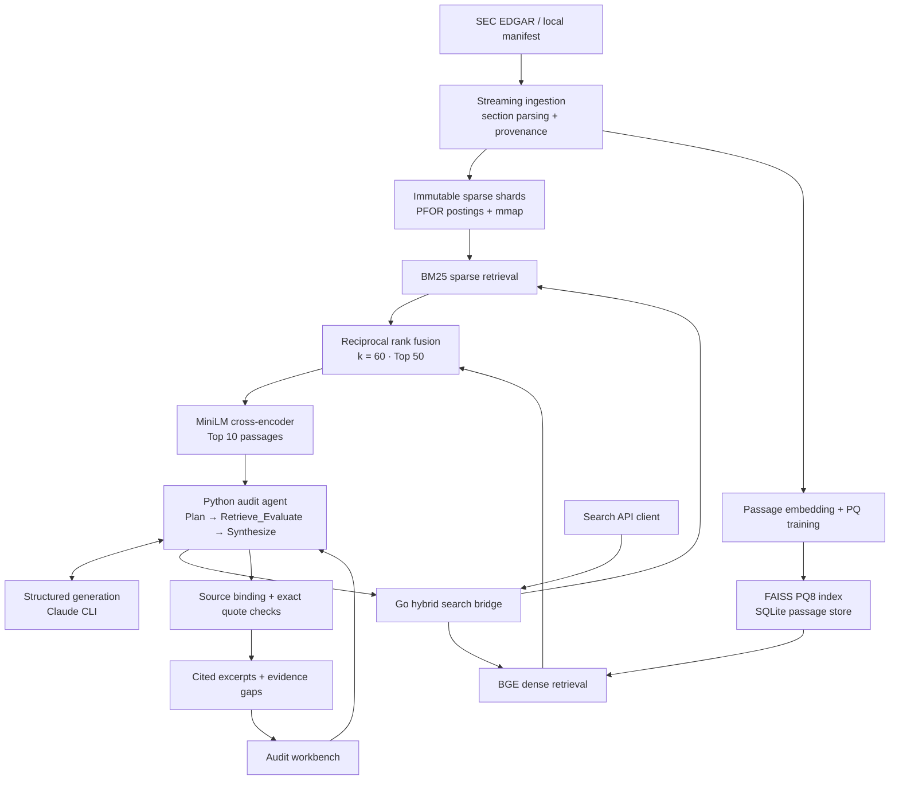

<div align="center">

# FinFilings AI

### Financial filing search. Evidence-grounded audits.

A Go and Python retrieval system for searching SEC filings, asking multi-step financial questions, and inspecting the original evidence behind every published excerpt.

[](https://github.com/JCHETAN26/FinFilings-AI/actions/workflows/ci.yml)
[](https://go.dev/)
[](https://www.python.org/)
[](https://pytorch.org/)
[](https://github.com/facebookresearch/faiss)
[](https://onnxruntime.ai/)
<br>
[](https://fastapi.tiangolo.com/)
[](https://docs.pydantic.dev/)
[](https://www.sqlite.org/)
[](ui/)
[](https://www.kernel.org/)

[Overview](#overview) · [Architecture](#architecture) · [Results](#verified-results) · [Setup](#getting-started) · [Documentation](#documentation)

</div>

For an isolated CPU install, portable parser-v3 artifacts, and a single startup command, see the [reproducible setup guide](docs/build/reproducible-setup.md). Setup verification requires no model-provider calls. Versioned delivery, activation and rollback are described in the [artifact manager guide](docs/build/versioned-artifacts.md).

## Overview

FinFilings AI helps analysts and developers investigate financial disclosures with an inspectable evidence trail. It combines a custom compressed search engine, semantic retrieval, and a bounded audit agent over SEC EDGAR filings.

Ask a question such as:

> Audit NVDA filing year 2024: separately retrieve export control risks and dependence on external manufacturing capacity. Explain with filing excerpts only.

The agent splits the question into targeted searches, retrieves passages within explicit filing filters, evaluates their relevance, and returns exact excerpts with citation tags, accession numbers, and SEC links. The workbench exposes the search plan, supporting passages, retries, and evidence gaps so the result can be checked against its source.

The project demonstrates systems engineering, information retrieval, and agent orchestration in one runnable stack. The evaluated corpus contains **49,406 SEC and FinQA passages**, with **152 SEC filings enrolled for source verification**. It is a local research and portfolio implementation; authentication, tenant isolation, and distributed deployment are future work.

### Core capabilities

| Capability | Implementation |
|---|---|
| Streaming ingestion | Identified, rate-limited EDGAR acquisition; deterministic Item 1A, Item 7, and Item 8 extraction; immutable shards |
| Compressed sparse search | Go BM25 engine, delta/PFOR postings, read-only `mmap`, pooled scratch buffers, bounded workers |
| Semantic retrieval | BGE embeddings in FAISS PQ8; disk-backed passage text and metadata |
| Hybrid ranking | Parallel sparse/dense retrieval, reciprocal rank fusion, cross-encoder reranking |
| Multi-step audits | Typed planning, parallel subqueries, relevance grading, at most two rewrites per subquery |
| Citation grounding | Exact quote checks, accession binding, source links, explicit evidence gaps |
| Local workbench | Questions, evidence inspection, citation highlights, execution diagnostics |
| Reproducible evaluation | Retrieval quality, vector memory, concurrent HTTP load, and source-verification reports |

## Workbench


*Real results from the Claude-backed UI verification.*

The UI accepts one active audit at a time and exposes passage text, filing metadata, rejected proposals, and missing-evidence flags. It binds to loopback and is intended for a single local user.

## Architecture



### Engineering decisions

- **Disk-backed storage:** immutable segment files and read-only mappings keep passage collections out of ordinary in-memory lists. SQLite stores text and metadata; FAISS serves quantized vector codes.
- **Compression with explicit coverage:** delta/PFOR includes SSE2 packing/unpacking for 8- and 16-bit widths on amd64. Other widths and platforms use scalar kernels.
- **Fusion before reranking:** RRF combines rank positions without assuming comparable sparse/dense score scales. The cross-encoder scores the fused Top-50 candidates and returns Top-10.
- **Bounded execution:** Go admission limits and worker pools, a validated Python profile of four workers × two threads, at most two agent model calls, and one active UI audit.
- **Fail-closed grounding:** filing filters stay fixed across rewrites. Unsupported quotes are dropped and evidence gaps remain visible. Filing year and fiscal-period end are tracked separately.

### Technology stack

| Layer | Technology |
|---|---|
| Storage and sparse retrieval | Go, BM25, PFOR, SSE2, `syscall.Mmap`, `sync.Pool` |
| Ingestion | Python streaming HTML/text parsing, Go shard writer, SHA-256 provenance |
| Embeddings | `BAAI/bge-small-en-v1.5` — 384 dimensions |
| Dense index | FAISS `IndexPQ`, 8-bit sub-vector quantization; current profile uses 128-byte codes |
| Fusion and reranking | RRF (`k=60`), `cross-encoder/ms-marco-MiniLM-L6-v2`, FP32 ONNX Runtime; PyTorch path retained |
| Agent and API | Python, Pydantic, asyncio, HTTPX, FastAPI, Uvicorn |
| Generation | Authenticated Claude Code CLI with structured JSON outputs and tools disabled |
| Passage store | SQLite |
| Front end | HTML, CSS, native JavaScript |
| Evaluation | ranx, NumPy, Go HTTP load harness, source/quote verification scripts |

Embedding and reranking models are pretrained, not project-specific fine-tunes. Datasets, weights, generated indexes, binaries, and runtime caches are excluded from Git.

## Verified results

Metrics come from saved runs. **Corpus version, provider, and workload matter:** the rows below are not one combined benchmark.

### Retrieval and concurrent serving

The current 49,406-passage snapshot has mixed parser lineage: only Morgan Stanley was reparsed with parser v3. Retrieval and load tests used an AMD Ryzen 7 5800H, Linux, CPU inference, and four inference workers × two threads.

| Measurement | Verified result | Conditions |
|---|---:|---|
| BM25 nDCG@10 | **0.4961** | 100 FinQA development queries |
| Dense PQ128 nDCG@10 | **0.4673** | Same queries and corpus |
| Hybrid RRF nDCG@10 | **0.5100** | Same queries and corpus |
| Reranked nDCG@10 | **0.5540** | Top-50 cross-encoder reranking |
| PQ recall@10 vs. exact float32 | **84.1%** | Same 100 queries |
| Native vector payload reduction | **91.15%** | Codes and FAISS buffers vs. float32; not process RSS |
| Hybrid HTTP p50 / p95 / p99 | **39.277 / 43.207 / 45.000 s** | 50 clients, 200 requests |
| Dense HTTP p50 / p95 / p99 | **0.341 / 0.518 / 0.557 s** | Separate 50-client, 200-request scenario |
| HTTP failures | **0/400** | 200 hybrid + 200 dense requests |

These are finite, warm, closed-loop runs on a non-isolated laptop, not sustained capacity or an SLA. FinQA labels evaluate published supporting facts; SEC passages are not exhaustively labeled. Dense-only nDCG@10 declined from **0.4823 to 0.4673** during corpus adoption; that regression is preserved in the report.

[Retrieval, load, memory, and regression evidence →](bench_kit/results/parser-v3-adoption-20261101/RESULTS.md)

### Agent and provider validation

| Run | Verified outcome | Scope |
|---|---|---|
| Claude fast-mode suite | **30/30 cases**, 140 exact-verified citations, 52/52 available subqueries cited | Recovered 18 + 12-case execution; 27 supported and 3 expected-unavailable outcomes |
| Paired agent latency | Median **29.71 → 23.50 s**; **20.9% reduction** | Eight primary supported runs per mode within a 24-run paired experiment |

Citation checks establish source binding, not a human-labeled accuracy score. The 30-case suite contains source-informed regression fixtures. The paired latency experiment is small and does not establish an SLA or latency distribution.

[Agent latency and 30-case evidence](bench_kit/results/audit-latency-20261102/RESULTS.md)

Historical foundation measurements include **20,352 passages/s indexing**, **0.048 ms sparse p99**, and **42–45 MiB post-load RSS**, measured on 702 real SEC passages. The original **0.5757 nDCG@10** used a different, 19,511-passage corpus. Original conditions and raw evidence remain in the [consolidated report](bench_kit/RESULTS.md).

## Getting started

### Prerequisites and dependencies

- Linux, Go **1.24+**, and Python **3.10**.
- Dependencies from [`py/requirements.txt`](py/requirements.txt), including PyTorch and FAISS.
- Locally prepared data, model weights, and indexes; these are not bundled in Git.
- For audits: an installed, authenticated Claude Code CLI. Search alone does not require a generation provider.

```bash
git clone https://github.com/JCHETAN26/FinFilings-AI.git
cd FinFilings-AI
python3 -m venv .venv
source .venv/bin/activate
python -m pip install --upgrade pip
python -m pip install torch==2.10.0 --index-url https://download.pytorch.org/whl/cpu
python -m pip install -r py/requirements.txt
python -m pip install -r py/requirements-onnx.txt

export PYTHONPATH="$PWD/py"
export HF_HOME="$PWD/models/hf-cache"
export OPENBLAS_NUM_THREADS=1 OMP_NUM_THREADS=2 NUMBA_NUM_THREADS=4
```

On filesystems without symlink support, create the virtual environment on a filesystem that supports them. Keep large artifacts on persistent storage.

### Launch the audit workbench

The supervisor starts one retrieval stack and the UI, verifies fingerprints, and cleans up its owned services on exit. Defaults target the evaluated expanded corpus and require these existing artifacts:

| Artifact | Default location |
|---|---|
| Corpus and provenance | `data/sec-scale-v3-evaluation-20261101/` |
| Ingestion report | `indexes/sec-scale-v3-20261101/report.json` |
| Sparse shards | `indexes/sparse-sec-scale-v3-20261101/` |
| Vector index | `indexes/vector-sec-scale-v3-pq128-20261101/` |
| ONNX reranker | `models/reranker-onnx-fp32-optimized-20261031/` |
| Original provenance and model artifacts | See [workbench requirements](docs/build/audit-ui.md#requirements-and-offline-artifacts) |

With the artifacts prepared and Claude Code installed, sign in and start the workbench:

```bash
claude auth login
python3 scripts/serve-audit-ui.py
```

Open **http://127.0.0.1:8766/**. See the [workbench guide](docs/build/audit-ui.md) for detailed setup and limits.

Run one launcher and stop manual retrieval services first. The launcher downloads nothing. Fresh clones must prepare expanded artifacts using the [ingestion guide](docs/ingestion/README.md) and [corpus build runbook](docs/build/parser-v3-adoption.md).

For access from a Mac over SSH:

```bash
ssh -N -L 8766:127.0.0.1:8766 USER@HOST
```

If the local forwarded port differs, pass `--tunnel-local-port PORT` to the launcher for its Host allowlist.

<details>
<summary><strong>Fresh-clone baseline: prepare data and run the search API</strong></summary>

This builds the original four-filing/FinQA baseline, not the expanded UI corpus. Downloads require network access and a real project/contact SEC User-Agent.

```bash
export SEC_USER_AGENT='YourProject your.email@example.com'
export HF_HUB_DISABLE_XET=1
python bench_kit/prepare_sec.py
python bench_kit/fetch_finqa.py --user-agent "$SEC_USER_AGENT"
python bench_kit/prepare_finqa.py --train-contexts 500 --query-limit 100
python py/fetch_models.py --cache-dir "$HF_HOME/hub"
python py/embed.py
mkdir -p models/bin
go build -o models/bin/finfilings ./cmd/finfilings
./models/bin/finfilings -mode build
```

Start `python py/service.py` in one terminal and `./models/bin/finfilings -mode serve` in another, with the environment above active. Defaults bind the sidecar to **8766** and Go bridge to **8765**. The manual sidecar occupies the UI's default port; stop it before launching the workbench.

```bash
curl --fail --silent --show-error http://127.0.0.1:8765/search \
  -H 'Content-Type: application/json' \
  --data '{"query":"supply-chain manufacturing risks","rerank":true,"filters":{"ticker":"AAPL","year":2023}}'
```

Responses include sparse, dense, fused, and reranked results. Builds require fresh output directories. Model revisions and acquisition provenance are recorded; do not attribute historical metrics to a newly built corpus without verification.

</details>

## Testing and evaluation

The [Go CI workflow](.github/workflows/ci.yml) runs unit tests, the race detector, scalar-fallback tests, and `go vet` on pushes and pull requests. It uses no SEC downloads, model weights, or generation calls. The badge reports the workflow's actual GitHub status; artifact-dependent Python evaluations run separately with prepared local data and models.

```bash
go test ./...
go test -race ./...
go test -tags=purego ./...
go vet ./...

# After installing dependencies and preparing required local artifacts:
python -m unittest discover -s py -p 'test_*.py'
python -m unittest discover -s bench_kit -p 'test_*.py'
```

The published fast-mode verification records **192 application tests** and **216 benchmark-harness tests**, plus Go checks. These are saved local results, not GitHub CI counts. HTTP tests need loopback sockets; real-file resource tests are opt-in. Synthetic inputs are labeled test fixtures, never benchmark evidence.

Use [`bench_kit/`](bench_kit/README.md) for retrieval quality, PQ recall/memory, load, and audit evaluation. Audit evaluators perform real Claude generation. Stop the UI before running supervisors that start their own services. Reports retain failed attempts, observations, hashes, and limitations.

## Repository structure

| Directory | Responsibility |
|---|---|
| [`pkg/index/`](pkg/index/) | Compression, SIMD, mmap loading, BM25, shard routing |
| [`pkg/ingest/`](pkg/ingest/) | EDGAR ingestion, deterministic parsing, immutable shards |
| [`pkg/hybrid/`](pkg/hybrid/), [`cmd/finfilings/`](cmd/finfilings/) | Parallel retrieval, RRF, HTTP bridge |
| [`pkg/model/`](pkg/model/) | SEC passage model and filing predicates |
| [`py/`](py/) | Embeddings, FAISS construction, inference sidecar, reranking |
| [`py/ingest/`](py/ingest/) | Streaming acquisition/parser pipeline, manifest orchestration |
| [`py/agent/`](py/agent/) | Providers, planner, critic, state machine, grounding |
| [`py/audit_web/`](py/audit_web/), [`ui/`](ui/) | Audit API, job admission, evidence browser |
| [`bench_kit/`](bench_kit/) | Evaluation harnesses, frozen suites, measured results |
| [`scripts/`](scripts/) | Launchers, verification, service supervision |
| [`docs/`](docs/) | Setup, design decisions, build history, reproduction guides |

## Scope and next steps

- **Local, single-user operation.** Authentication, tenant isolation, distributed serving, and availability guarantees are not implemented.
- **Extractive answers.** Results are verified source excerpts. Independently validated calculations and abstractive financial conclusions are outside the current implementation.
- **Corpus coverage.** The model supports 10-K/10-Q forms; verification centers on 10-K filings. Parser coverage varies by layout, ambiguous sections fail for review, and some original passages remain unclassified.
- **Evaluation limits.** FinQA development queries and source-informed audit fixtures do not establish held-out SEC accuracy. FinQA passages lack verified SEC accessions and cannot become published audit evidence.
- **Local-model support.** An experimental Ollama integration is being developed locally and is not included in this publication. Provider validation and lower local audit latency remain open.

## Documentation

| Guide | Contents |
|---|---|
| [Workbench](docs/build/audit-ui.md) | UI setup, artifacts, endpoints, limits |
| [Streaming ingestion](docs/ingestion/README.md) | Manifests, SEC access, deterministic sections, atomic shards |
| [Ingestion implementation](docs/build/edgar-ingest.md) | Parser evolution and resource checks |
| [Benchmark suite](bench_kit/README.md) | Workloads, harnesses, reproduction commands |
| [Consolidated results](bench_kit/RESULTS.md) | Historical Phase 1–4 metrics and conditions |
| [Frozen audit suites](bench_kit/suites/README.md) | Fixture provenance, coverage definitions, gates |
| [Agent fast mode](docs/build/agent-latency.md) | Quote selection, host checks, paired latency design |
