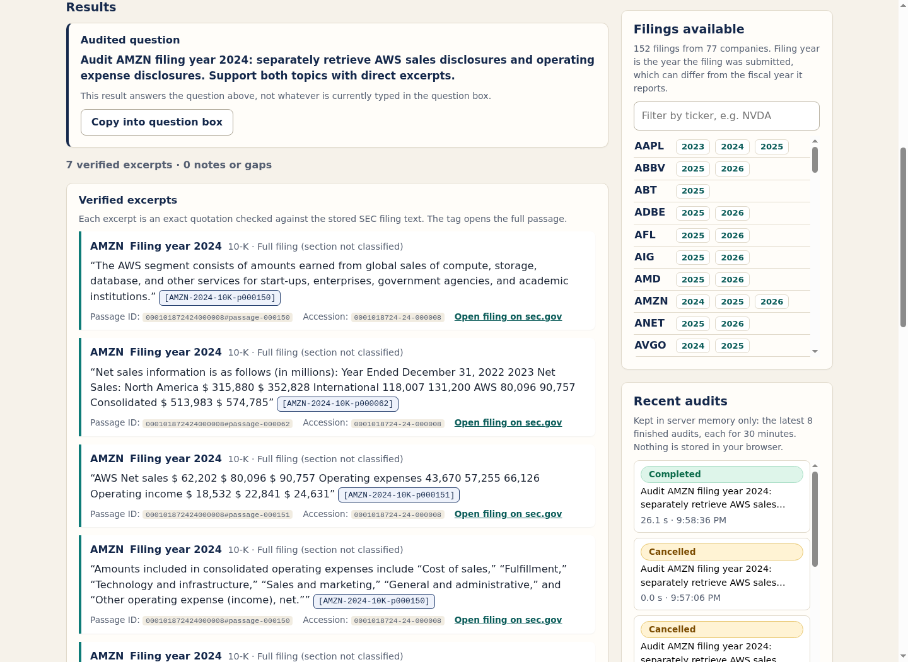

# Local audit workbench — live verification (November 2, 2026)

Verification of the local, single-user audit workbench (`py/audit_web/`, `ui/`, `scripts/serve-audit-ui.py`; design and limits in [docs/build/audit-ui.md](../../../docs/build/audit-ui.md)). Raw evidence is in this directory: `verification/` (logs and JSON checks) and `live/` (API results and screenshots). Nothing here is a retrieval-quality, answer-accuracy or load-latency benchmark; the checks are **source and structural**: do the quotes, passages, links and bounds match the stored SEC corpus and the design.

**Outcome:** every technical check passed ([`technical-release-checks.json`](verification/technical-release-checks.json)), and the final documentation review and staged-snapshot scan are recorded in [`final-release-checks.json`](verification/final-release-checks.json) and [`public-snapshot-check.json`](verification/public-snapshot-check.json), which Codex creates before publication. Nothing was deployed, no authentication or tenancy exists, and no service was left running. This report does not say the work has been pushed; Git history records that.

Other screenshots: [evidence detail, desktop](live/evidence-desktop.png) · [evidence detail, mobile](live/evidence-mobile.png) · [empty landing page](live/workbench-empty-desktop-final.png).

## Tests

| Suite | Result | Log |
|---|---|---|
| Application tests (final) | 167 passed | [`python-tests-final.log`](verification/python-tests-final.log) |
| Application tests before the launcher fix (preserved) | 165 passed | [`python-tests.log`](verification/python-tests.log) |
| Benchmark-contract tests | 168 passed | [`benchmark-tests.log`](verification/benchmark-tests.log) |

The benchmark log also contains the gate consolidator's own output, which evaluates only the quality and load gates and lists the agent gate as "not evaluated" (hence its `OVERALL NOT PASSED` line); that is not a UI result.

Unchanged-code evidence: [`unchanged-core-and-artifacts.json`](verification/unchanged-core-and-artifacts.json) shows the core agent, retrieval and ranking code, the Go retrieval stack, models and indexes unchanged (56 code files, 5 vector and 2 reranker files, 28 sparse files hashed). The 15 API/frontend files were unchanged throughout the live browser checks; only the launcher changed afterwards ([`ui-source-hashes-final.json`](verification/ui-source-hashes-final.json)).

## Real browser, real services: three frozen scenarios

Chrome 139 ([`browser-version.json`](verification/browser-version.json)) drove the real UI against the real sidecar, bridge, corpus and Claude CLI. Raw API results: [`audit04`](live/audit04.json), [`audit10`](live/audit10.json), [`broad30`](live/broad30.json); checks: [`browser-live-checks.json`](verification/browser-live-checks.json), [`live-source-verification.json`](verification/live-source-verification.json).

| Scenario | Scope | Citations | Gap flags | Retries | Retrieval calls | Job time |
|---|---|---|---|---|---|---|
| `audit04` | AMZN 2024, two topics | 7 | 0 | 0 | 2 | 25.169 s |
| `audit10` | MSFT 2024, exact `Item 1A` section, absent | 0 | 3 (expected) | 4 | 6 | 18.304 s |
| `broad30` | KO 2025 `Item 7` (available) + AMZN 2024 `Item 7` (exact section absent) | 6 | 2 (expected) | 1 | 3 | 20.586 s |

Values are from [`live-source-verification.json`](verification/live-source-verification.json) (retries = searches after a first attempt; retrieval calls = all searches).

Exact gap strings shown by the UI:

- `audit10`: "Subquery 0 has no evidence meeting threshold after 2 retries.", "Subquery 1 has no evidence meeting threshold after 2 retries.", "No verified answer; evidence unavailable or below threshold."
- `broad30`: "Subquery 1 has no evidence meeting threshold after 1 retries.", "Subquery 1 stopped early: no verified evidence and the critic proposed no new query (stalled rewrite)."

`broad30` shows the typed `stalled_rewrite` stop live: the absent side (exact `Item 7` in AMZN 2024) returned no verified evidence, the critic proposed no new wording, and the search stopped after one retry. The earlier full 30-case run had no such case. No threshold or filter was relaxed.

Independent source check of the primary scenarios: 14 unique retrieved passages (including ones that were retrieved but not cited) were checked against the original corpus bytes and trusted provenance metadata, and the 13 published citations were verified separately for exact quote spans; all 3 available planned subqueries are cited. This is source/structural verification, not an answer-accuracy or human-gold evaluation.

In the browser: displayed quotes equal the API quotes exactly; the original audited question is shown; the evidence dialog shows the full passage with the quote highlighted and the sec.gov URL, Escape closes it, and the skip link is reachable by keyboard (focus return after closing was not asserted); desktop 1440×1050 and mobile 390×844 fit; zero runtime errors in the primary checks.

## Additional browser checks

[`browser-additional-checks.json`](verification/browser-additional-checks.json) and its logs cover history/draft association, clearing stale evidence after an accepted submission, and browser cancellation; these used **real live jobs**. Only the hostile-text and hostile-link checks used an explicitly labeled browser-only **controlled mock response**; they are security fixture checks, not SEC or model results. The separate Node fake-DOM flow tests in the repository are fixtures too and are not browser evidence.

## Security probes

Actual requests exercised Host, Origin, CSRF header, content-type, 16 KiB body, 8 KiB UTF-8 prompt, chunked-body, traversal and unknown-file cases; all behaved as designed.

## Admission and cancellation

A burst of 20 concurrent API submissions produced **1×202 and 19×429**, no queue. The real Claude CLI process of the active audit was cancelled and gone before the next admission, and an immediate second cancel was clean ([`live-admission-cancellation.json`](verification/live-admission-cancellation.json), 32 checks). This is **not** a 50-client hybrid latency or sustained-QPS benchmark; no p50/p99 is reported.

Bounded defaults as configured: 1 active audit, 0 queue, at most 8 finished jobs kept (hard cap) and available for 30 minutes after finishing (enforced when jobs are accessed or pruned; not guaranteed physical erasure at 30 minutes), 1 MiB projected result, 600 s job deadline (excluding cleanup), 180 s per model call, 2 concurrent model calls, 3 subqueries, 2 retries, at most 5 passages per search context, 4×2 sidecar inference, UI uvicorn 32 connections / backlog 64. The sidecar admission recorded peak 2 and 0 rejections during the checks. The shutdown 45 s value is a warning interval: shutdown keeps waiting for actual cleanup and has no hard cutoff.

## Extra audit and harness corrections (kept distinct)

- A separate real AMZN audit (6 citations, 26.146 s, 9 unique passages independently checked) was started by a harness error and is preserved separately: [`audit04-extra-from-harness.json`](live/audit04-extra-from-harness.json), [`extra-audit-and-harness-notes.json`](verification/extra-audit-and-harness-notes.json).
- Harness errors, preserved and not product defects: a wrong CSS selector ([`browser-additional.log`](verification/browser-additional.log)); an asynchronous submission checked before the 202 arrived ([`02`](verification/browser-additional-02.log)); an ambiguous selection that picked the new extra audit instead of the expected 7-citation one ([`03`](verification/browser-additional-03.log)); the corrected run that passed using exact IDs and an async wait ([`04`](verification/browser-additional-04.log)).
- Totals, not cherry-picked: 3 primary scenarios with 13 citations plus the extra audit's 6 give 19 verified quote occurrences across 4 completed jobs. Jobs started only to test cancellation or shutdown produced no financial result.

## Launcher shutdown bug and fix

During a real active audit, SIGTERM stopped all owned process groups in under a second, but the launcher recorded `status: failed`, `error: SystemExit` for this expected stop. The raw records are preserved unedited: [`launcher-run-status.json`](verification/launcher-run-status.json), [`shutdown-observations.json`](verification/shutdown-observations.json). The fix added a dedicated `Terminated` exception and a pure `classify_exit` helper (Ctrl-C and the launcher's own SIGTERM are `stopped` with `stop_reason` `interrupt`/`SIGTERM`; everything else stays `failed`) and a finite 1–600 s `--startup-timeout`. After the fix, a real active-audit shutdown ([`shutdown-final.json`](verification/shutdown-final.json)) cleaned up all groups with `status: stopped`, `stop_reason: SIGTERM` and the conventional exit 143. Both run histories are preserved, no orphans remain, and the isolated browser was cleaned up ([`browser-cleanup.json`](verification/browser-cleanup.json)). Raw artifacts are sealed in [`raw-artifact-seal.json`](verification/raw-artifact-seal.json) (40 files).

## Limitations

- Source/structural checks on three frozen scenarios plus one extra audit; no answer-accuracy, human-gold or load-latency claim.
- Local, single-user, unauthenticated, loopback only; not deployed; no tenancy or cloud claim. A local process that can reach the port can run audits.
- Job history is in server memory only (no `localStorage`) and is lost on restart.
- On exFAT, POSIX modes are not enforced, so no confidentiality is claimed from file modes. Logs and questions stay local; sidecar and bridge logs are unrotated and old run directories are not pruned.
- Launching needs the offline artifacts and a signed-in Claude CLI (`python3 scripts/serve-audit-ui.py`, then `http://127.0.0.1:8766/`; SSH-tunnel instructions in the design doc).
- Publication of this work is recorded in Git after the independent push, not by this report.
